# UPSC Civil Services: Historical Dynasties & Royal Lineages Compendium
*A High-Yield Chronological Reference for UPSC CSE Prelims & Mains (GS-1 / History Optional)*

---

## Table of Contents
1. [Ancient India: Magadha to Guptas & Harsha](#1-ancient-india)
   - Magadhan Dynasties (Haryanka, Shishunaga, Nanda)
   - Mauryan Empire & Post-Mauryan Rulers (Shunga, Kanva, Chedi)
   - Satavahanas of Deccan
   - Kushanas & Western Kshatrapas
   - Imperial Guptas & Vakatakas
   - Pushyabhutis (Harshavardhana) & Maukharis
2. [Peninsular & Early Medieval Dynasties](#2-peninsular--early-medieval-dynasties)
   - Early Western Chalukyas of Badami
   - Pallavas of Kanchipuram
   - Rashtrakutas of Manyakheta
   - Imperial Cholas of Tanjore
   - Tripartite Struggle (Gurjara-Pratiharas, Palas, Rashtrakutas)
   - Western Chalukyas of Kalyani & Eastern Chalukyas of Vengi
   - Later Deccan Powers: Hoysalas, Kakatiyas, Yadavas, Pandyas
3. [Medieval India: Delhi Sultanate & Regional Kingdoms](#3-medieval-india)
   - Delhi Sultanate (Mamluk, Khalji, Tughlaq, Sayyid, Lodi)
   - Vijayanagara Empire (Sangama, Saluva, Tuluva, Aravidu)
   - Bahmani Kingdom & The Five Deccan Sultanates
4. [Mughal Empire & Maratha Swarajya](#4-mughal-empire--maratha-swarajya)
   - Great Mughals & Sur Interregnum
   - Later Mughals & Disintegration
   - Maratha Empire (Chhatrapatis & Peshwas)
5. [18th-Century Successor States & Modern Transition](#5-18th-century-successor-states)
   - Nawabs of Bengal & Awadh
   - Asaf Jahi Nizams of Hyderabad
   - Kingdom of Mysore (Wodeyars, Hyder Ali, Tipu Sultan)
   - Sikh Empire (Misls & Maharaja Ranjit Singh)

---

## 1. Ancient India

### 1.1 Magadhan Ascendancy (6th – 4th Century BCE)

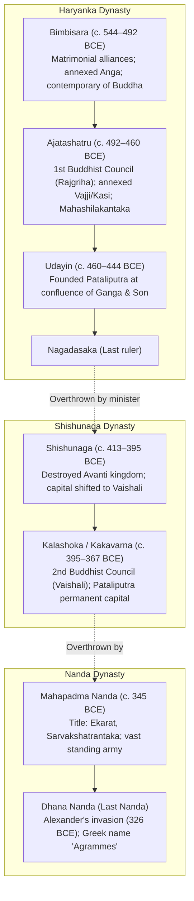

#### Key UPSC Exam Hooks
- **Bimbisara**: Sent personal physician **Jivaka** to treat Avanti King Pradyota; established royal bureaucracy (*Mahamatras*).
- **Ajatashatru**: Patrons of both Jainism and Buddhism; military innovations: *Rathamusala* (scythed chariot) and *Mahashilakantaka* (catapult).
- **Mahapadma Nanda**: Hathigumpha inscription of Kharavela mentions a canal dug by King Nanda in Kalinga.

---

### 1.2 The Mauryan Empire (c. 322 – 185 BCE)

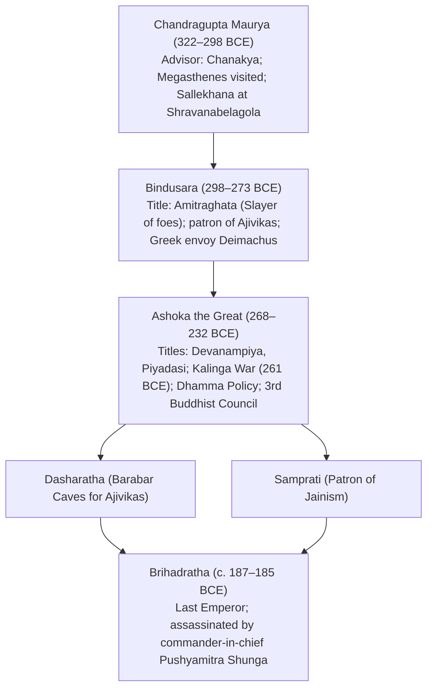

#### Essential UPSC Inscriptions & Administrative Terms
- **Major Rock Edict XIII**: Records Kalinga War trauma and victory through *Dhammavijaya*.
- **Major Rock Edict XII**: Religious tolerance (*Sarvadharma Sambhava*).
- **Rummindei Pillar Inscription**: Tax relief (*Bali* abolished, *Bhaga* reduced to 1/8th) at Buddha’s birthplace Lumbini.
- **Key Officers**: *Samaharta* (Chief Collector of Revenue), *Sannidhata* (Chief Treasury Custodian), *Rajukas* (Judicial/Land survey officers), *Dhamma Mahamattas* (Disseminators of Dhamma).

---

### 1.3 Post-Mauryan Dynasties (North & Central India)

#### Shunga Dynasty (c. 185 – 73 BCE)
1. **Pushyamitra Shunga** (Founder; performed two *Ashvamedha* sacrifices; patronized **Patanjali** who wrote *Mahabhasya*; Ayodhya inscription of Dhanadeva).
2. **Agnimitra** (Hero of Kalidasa's drama *Malavikagnimitram*; Vidisha as regional capital).
3. **Bhagabhadra** (Heliodorus Pillar / Besnagar Garuda Pillar erected by Greek ambassador Heliodorus of Taxila, declaring himself *Bhagavata*).
4. **Devabhuti** (Last ruler; killed by his Brahmin minister Vasudeva Kanva).

#### Kanva Dynasty (c. 73 – 28 BCE)
- Rulers: **Vasudeva** $\rightarrow$ **Bhumimitra** $\rightarrow$ **Narayana** $\rightarrow$ **Susharman** (Dynasty ended by Satavahana expansion).

#### Chedi / Mahameghavahana Dynasty of Kalinga (1st Century BCE)
- **Kharavela**: Third ruler; author of the famous **Hathigumpha Inscription** (Prakrit language in Brahmi script, Udayagiri caves); champion of Jainism; revived Kalinga irrigation and defeated the *Tamira-deha-sanghata* (confederacy of Tamil states).

---

### 1.4 Satavahana Dynasty of Deccan (c. 1st Century BCE – 3rd Century CE)

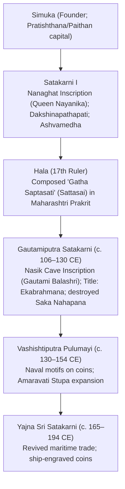

#### UPSC Exam Anchors
- **First Indian Dynasty** to issue royal **land grants (*Brahmadeya*) with tax immunities** to Buddhist monks and Brahmins.
- **Matronymics**: Named after mothers (*Gautami-putra*, *Vashishti-putra*), yet succession remained **patrilineal**.
- **Architecture**: Rock-cut Chaityas and Viharas at Karle, Bhaja, Kanheri, Nasik; Amaravati & Nagarjunakonda white marble stupas.

---

### 1.5 Indo-Greeks, Sakas & Kushanas

#### Indo-Greeks
- **Menander I (Milinda)** (c. 165–145 BCE): Capital at Sakala (Sialkot); converted to Buddhism by Nagasena, recorded in the Buddhist philosophical text **Milinda-Panha** (*Questions of Menander*); first to issue gold coins with royal portraits and bilingual legends.

#### Western Kshatrapas (Sakas)
- **Rudradaman I (c. 130–150 CE)**: Kardamaka dynasty; authored the **Junagadh Rock Inscription** (first major chaste Sanskrit long inscription); repaired the embankment of **Sudarshana Lake** in Saurashtra (originally constructed under Chandragupta Maurya and improved under Ashoka) using his personal treasury without taxing citizens.

#### Kushana Empire (c. 1st – 3rd Century CE)
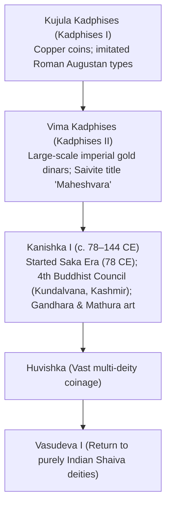
- **Kanishka’s Court**: Asvaghosa (*Buddhacharita*, *Saundarananda*), Nagarjuna (*Madhyamaka* philosophy), Vasumitra (*Mahavibhasa*), Charaka (*Charaka Samhita*), Agesilaos (Greek architect).
- **Rabatak Inscription**: Deciphered by Nicholas Sims-Williams in Bactrian language; confirms lineage: Kujula Kadphises $\rightarrow$ Vima Taktu $\rightarrow$ Vima Kadphises $\rightarrow$ Kanishka.

---

### 1.6 The Imperial Guptas (c. 319 – 550 CE)

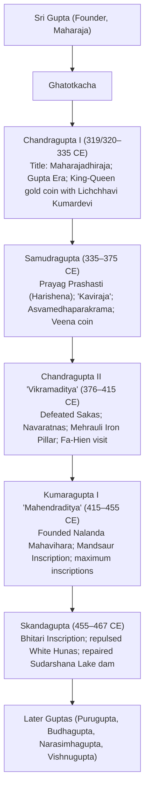

#### Critical Administrative & Epigraphic Terms
- **Administrative Hierarchy**: *Bhukti* (Province, head: *Uparika*) $\rightarrow$ *Vishaya* (District, head: *Vishayapati*) $\rightarrow$ *Vithi* (Sub-district) $\rightarrow$ *Gram* (Village, head: *Gramika*).
- **Prayag Prashasti Policy**:
  - *Aryavarta* (9 kings): *Prasabhoddharana* (violent extermination and direct annexation).
  - *Dakshinapatha* (12 kings): *Grahana-Moksha-Anugraha* (capture, liberation, and reinstatement as tributaries).
  - Frontier States (*Atavika* & Border): *Sarvakaradana-Ajnakarana-Pranamanagamana* (payment of all taxes, obeying imperial orders).

---

### 1.7 Vakatakas of Deccan (c. 250 – 500 CE)
- **Vindhyashakti** (Founder) $\rightarrow$ **Pravarasena I** (Only ruler with imperial title *Samrat*; performed 4 *Ashvamedhas*).
- Dynasty split into two branches:
  1. **Pravarapura-Nandivardhana Branch**: Rudrasena II married **Prabhavatigupta** (daughter of Chandragupta II). Upon his early death, Prabhavatigupta ruled as queen regent; issued Pune and Riddhapur copper plates.
  2. **Vatsagulma (Washim) Branch**: **Harishena** (last great king; patron of Ajanta Rock-cut Caves 16, 17, and 19).

---

### 1.8 Pushyabhuti & Maukhari Dynasties (7th Century CE)
- **Prabhakaravardhana** (Pushyabhuti of Thanesar) had three children: Rajyavardhana, Harshavardhana, and Rajyashri.
- **Rajyashri** married **Grahavarman** (Maukhari King of Kannauj).
- **Harshavardhana (606–647 CE)**:
  - United Thanesar and Kannauj, moving the imperial capital to **Kannauj**.
  - Defeated by **Pulakeshin II** (Chalukya) on the banks of the Narmada (confirmed by Aihole Inscription).
  - Authored three Sanskrit dramas: *Ratnavali*, *Priyadarsika*, and *Nagananda*.
  - Court Poet **Banabhatta** authored *Harshacharita* and *Kadambari*.
  - Chinese pilgrim **Xuanzang (Hiuen Tsang)** visited; described the Kannauj Assembly and the quinquennial *Maha Moksha Parishad* at Prayag.

---

## 2. Peninsular & Early Medieval Dynasties

### 2.1 Early Western Chalukyas of Badami (c. 543 – 753 CE)

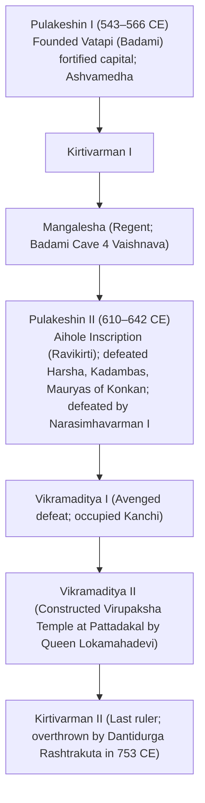

---

### 2.2 Pallavas of Kanchipuram (c. 575 – 897 CE)

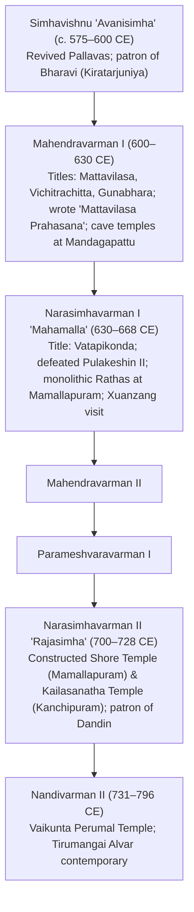

---

### 2.3 Rashtrakutas of Manyakheta (c. 753 – 973 CE)

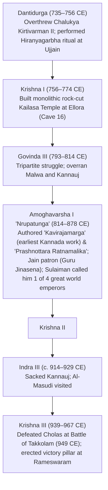

---

### 2.4 Imperial Cholas of Thanjavur (c. 850 – 1279 CE)

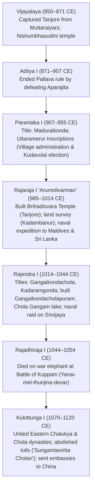

#### UPSC Core Administrative Details
- **Local Self-Government**:
  - **Ur**: General village assembly of tax-paying landholders.
  - **Sabha / Mahasabha**: Exclusively Brahmin assembly in *Brahmadeya* villages.
  - **Nagaram**: Assembly of merchants and commercial towns.
  - **Variyams (Committees)**: *Eri-variyam* (Tank committee), *Thotta-variyam* (Garden committee), *Pon-variyam* (Gold committee).
  - **Kudavolai System**: Secret ballot system using palm leaves drawn by an innocent boy from an earthen pot.

---

### 2.5 The Tripartite Struggle for Kannauj (8th – 10th Century)

| Empire | Capital / Region | Key Monarchs | Inscriptions / Literary Anchors |
| :--- | :--- | :--- | :--- |
| **Gurjara-Pratiharas** | Kannauj / Avanti | Nagabhata I, Vatsaraja, Nagabhata II, **Mihir Bhoja** (c. 836–885 CE), Mahendrapala I | - Mihir Bhoja assumed title *Adivaraha* (Barah copper plate)<br/>- Court poet **Rajashekhara** (*Kavyamimamsa*, *Karpuramanjari*, *Viddhasalabhanjika*) served Mahendrapala I |
| **Palas of Bengal** | Pataliputra / Gauda | **Gopala** (c. 750 CE, elected by people to end *Matsyanyaya*), **Dharmapala** (770–810 CE), **Devapala** (810–850 CE) | - Dharmapala founded **Vikramashila** & Somapura Mahaviharas; revived Nalanda<br/>- Devapala granted 5 villages to Nalanda on request of Maharaja Balaputradeva of **Sailendra Dynasty** (Sumatra)<br/>- Sandhyakar Nandi's *Ramacharitam* |
| **Rashtrakutas** | Manyakheta (Malkhed) | Dhruva, Govinda III, Indra III, Krishna III | - Sacked Kannauj multiple times without permanent annexation |

---

### 2.6 Regional Peninsular Powers (11th – 14th Century)

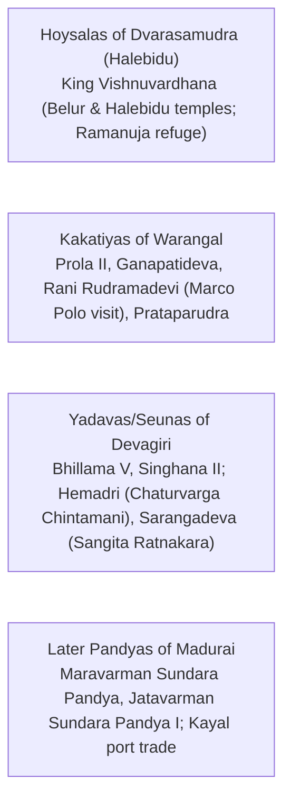
- **Kakatiya Motupalli Inscription**: Issued by Ganapatideva (*Abhaya Shasana*), guaranteeing protection and standard customs duty to foreign sea merchants.

---

## 3. Medieval India

### 3.1 Delhi Sultanate (1206 – 1526 CE)

```mermaid
flowchart TD
    subgraph Mamluk / Slave Dynasty (1206–1290)
        Aibak["Qutb-ud-din Aibak (1206–1210)<br/>Lakhbaksh; Quwwat-ul-Islam; started Qutb Minar"] --> Ilt["Shams-ud-din Iltutmish (1211–1236)<br/>Real founder; Silver Tanka & Copper Jital; Iqta System; Turkan-i-Chahalgani"]
        Ilt --> Razia["Razia Sultana (1236–1240)<br/>First woman monarch of Delhi; Altunia rebellion"]
        Razia --> Bal["Ghiyas-ud-din Balban (1266–1287)<br/>Blood & Iron policy; Sijda & Paibos; Nauroz; Diwan-i-Arz; Zill-i-Ilahi"]
    end
    Bal -. Khalji Revolution .-> JK
    subgraph Khalji Dynasty (1290–1320)
        JK["Jalal-ud-din Khalji (1290–1296)<br/>State based on willing support"] --> AK["Ala-ud-din Khalji (1296–1316)<br/>Market Control (Shahna-i-Mandi); Dagh & Chehra; Diwan-i-Mustakhraj; Alai Darwaza"]
    end
    AK -. Overthrown by Ghiyas .-> GT
    subgraph Tughlaq Dynasty (1320–1414)
        GT["Ghiyas-ud-din Tughlaq (1320–1325)<br/>Founded Tughlaqabad; pioneer in irrigation canals"] --> MBT["Muhammad bin Tughlaq (1325–1351)<br/>5 experiments: Capital transfer (Daulatabad), Token currency, Doab tax, Qarachil/Khurasan; Diwan-i-Kohi; Ibn Battuta"]
        MBT --> FST["Firoz Shah Tughlaq (1351–1388)<br/>Abolished 24 cesses; Haq-i-Shurb canal tax; Diwan-i-Bandagan (slaves); Diwan-i-Khairat; Jizya on Brahmins"]
    end
    FST -. Timur Invasion 1398 .-> Khizr
    subgraph Sayyid Dynasty (1414–1451)
        Khizr["Khizr Khan (1414–1421)<br/>Title: Rayat-i-Ala"] --> Mub["Mubarak Shah (Tarikh-i-Mubarak Shahi by Yahya Sirhindi)"]
    end
    Mub -. Abdication .-> Bahlul
    subgraph Lodi Dynasty (1451–1526 - Afghan)
        Bahlul["Bahlul Lodi (1451–1489)<br/>First Afghan rule; peer among equals"] --> Sik["Sikandar Lodi (1489–1517)<br/>Founded Agra (1504); Gaz-i-Sikandari; pen name 'Gulrukhi'"]
        Sik --> Ibr["Ibrahim Lodi (1517–1526)<br/>Defeated by Babur in 1st Battle of Panipat (1526)"]
    end
```

---

### 3.2 Vijayanagara Empire (1336 – 1646 CE)

```mermaid
flowchart TD
    subgraph Sangama Dynasty (1336–1485)
        H1B1["Harihara I & Bukka I (1336)<br/>Guided by Sage Vidyaranya; capital Vidyanagara/Hampi"] --> DR1["Deva Raya I (1406–1422)<br/>Tungabhadra dam; Nicolo Conti visited (1420)"]
        DR1 --> DR2["Deva Raya II 'Gajabetekara' (1424–1446)<br/>Recruited Muslim archers; Persian envoy Abdur Razzaq visited"]
    end
    DR2 -. First Usurpation .-> SN
    subgraph Saluva Dynasty (1485–1505)
        SN["Saluva Narasimha (1485–1491)"]
    end
    SN -. Second Usurpation .-> VN
    subgraph Tuluva Dynasty (1505–1570)
        VN["Vira Narasimha (1505–1509)"] --> KDR["Krishnadevaraya (1509–1529)<br/>Apex of Empire; Ashtadiggajas; authored 'Amuktamalyada' & 'Jambavati Kalyanam'; built Vijaya Vittala & Hazara Rama temples; Domingo Paes & Barbosa visited"]
        KDR --> ADR["Achyuta Deva Raya (1529–1542)<br/>Fernao Nuniz visited"] --> Sad["Sadashiva Raya & Regent Aliya Rama Raya<br/>Battle of Talikota / Rakshasi-Tangadi (1565) - Vijayanagara sacked"]
    end
    Sad -. Third Usurpation .-> Tir
    subgraph Aravidu Dynasty (1570–1646)
        Tir["Tirumala Raya (Capital Penukonda)"] --> Ven2["Venkata II (Shifted capital to Chandragiri; Jesuit mission)"]
    end
```

#### Vijayanagara Key Administrative Pillars
- **Nayankara System**: Military governors (*Amaranāyakas*) maintained soldiers, horses, and elephants for the Raya in exchange for revenue-yielding territories (*amaram*).
- **Ayagar System**: 12 hereditary village functionaries (Karnam, Talayari, etc.) remunerated through tax-free land (*manya*).

---

### 3.3 Bahmani Kingdom & Deccan Sultanates

- **Bahmani Kingdom (1347–1527)**:
  - Founded by **Alauddin Hasan Bahman Shah** (capital Gulbarga, later Bidar).
  - **Firuz Shah Bahmani**: Built observatory at Daulatabad; patron of astronomy.
  - **Mahmud Gawan**: Renowned Persian Prime Minister under Muhammad Shah III; established the **Madrasa of Mahmud Gawan** at Bidar; administrative reforms dividing the kingdom into 8 *Tarafs*.
- **The Five Deccan Sultanates**:
  1. **Adil Shahi of Bijapur** (1489–1686): Ibrahim Adil Shah II (*Jagadguru Badshah*, author of *Kitab-i-Navras*); built **Gol Gumbaz** (whispering gallery).
  2. **Nizam Shahi of Ahmadnagar** (1490–1633): Malik Ambar (guerrilla tactics *Bargir-giri*, revenue system based on Todar Mal's model); Chand Bibi defended against Akbar.
  3. **Qutb Shahi of Golconda** (1518–1687): Muhammad Quli Qutb Shah founded Hyderabad and built the **Charminar** (1591); center of diamond mining and Kalamkari textiles.
  4. **Imad Shahi of Berar** (1490–1574; absorbed by Ahmadnagar).
  5. **Barid Shahi of Bidar** (1492–1619; absorbed by Bijapur).

---

## 4. Mughal Empire & Maratha Swarajya

### 4.1 Great Mughals & Sur Interregnum (1526 – 1707 CE)

```mermaid
flowchart TD
    Bab["Zahir-ud-din Babur (1526–1530)<br/>Battles: Panipat (1526, Ibrahim Lodi), Khanwa (1527, Rana Sanga), Chanderi (1528), Ghaghra (1529); Tuzuk-i-Baburi in Chaghatai Turkic"] --> Hum["Nasir-ud-din Humayun (1530–40, 1555–56)<br/>Dinpanah capital; ousted by Sher Shah; regained throne with Persian Safavid aid"]
    Hum -. Ousted .-> Sher
    subgraph Sur Empire (1540–1555)
        Sher["Sher Shah Suri 'Farid' (1540–1545)<br/>Zabti land measurement; Rupiya (silver) & Dam (copper); Sadak-e-Azam (GT Road); Rohtas Fort; Purana Qila"] --> Islam["Islam Shah (Codified laws)"]
    end
    Islam -. Restored .-> Hum
    Hum --> Akb["Jalal-ud-din Akbar (1556–1605)<br/>2nd Panipat (1556); Mansabdari (Zat/Sawar); Dahsala System; Ibadat Khana (1575); Mahzarnama (1579); Sulh-i-Kul; Fatehpur Sikri"]
    Akb --> Jah["Nur-ud-din Jahangir (1605–1627)<br/>Zanjir-i-Adl (Chain of justice); Tuzuk-i-Jahangiri; Painting zenith (Mansur, Bishandas); William Hawkins & Sir Thomas Roe visits"]
    Jah --> SJ["Shah Jahan (1628–1658)<br/>Golden Age of Architecture: Taj Mahal, Red Fort, Jama Masjid, Peacock Throne; Francois Bernier & Jean-Baptiste Tavernier visits"]
    SJ --> Aur["Muhi-ud-din Aurangzeb 'Alamgir' (1658–1707)<br/>Reimposed Jizya (1679); discontinued Jharokha Darshan & court music; Fatawa-i-Alamgiri; annexed Bijapur (1686) & Golconda (1687)"]
```

---

### 4.2 Later Mughals & Imperial Decline (1707 – 1857 CE)

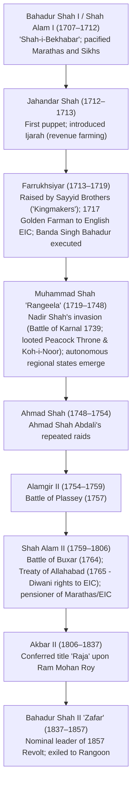

---

### 4.3 Maratha Empire: Chhatrapatis & Peshwas

```mermaid
flowchart TD
    subgraph Royal Chhatrapati House of Bhonsle
        Shahaji["Shahaji Bhonsle (Jagirdar of Pune & Supa)"] --> Shiv["Chhatrapati Shivaji Maharaj (1627/30–1680)<br/>Coronation 1674 at Raigad; Ashtapradhan; Chauth & Sardeshmukhi; Kathi rod"]
        Shiv --> Sambh["Chhatrapati Sambhaji (1680–1689)<br/>Executed by Aurangzeb at Tulapur"] & Rajaram["Chhatrapati Rajaram (1689–1700)<br/>Capital shifted to Jinji during Mughal siege"]
        Rajaram --> Tara["Maharani Tarabai (Regent for Shivaji II)<br/>Led Maratha resistance against Aurangzeb"]
        Sambh --> Shahu["Chhatrapati Shahu I (1707–1749)<br/>Released by Mughals; Battle of Khed (1707); appointed Balaji Vishwanath as Peshwa"]
    end
    subgraph Hereditary Peshwas of Pune
        BV["Balaji Vishwanath (1713–1720)<br/>Peshwaship becomes hereditary; 1719 agreement with Sayyid brothers"] --> BR1["Baji Rao I (1720–1740)<br/>Proponent of Hindu-Pad-Padshahi; Battle of Palkhed (1728, Nizam defeated); treaty of Duraha Sarai"]
        BR1 --> BBR["Balaji Baji Rao / Nana Saheb (1740–1761)<br/>Sangola Agreement (1750 - Peshwa de facto ruler); 3rd Battle of Panipat (1761 against Ahmad Shah Abdali)"]
        BBR --> MR1["Madhavrao I (1761–1772)<br/>Restored Maratha supremacy; supported Mahadji Shinde & Nana Fadnavis"]
        MR1 --> Nar["Narayanrao (Assassinated by Raghunathrao)"] --> SW["Sawai Madhavrao (Council of Barbhai led by Nana Fadnavis)"]
        SW --> BR2["Baji Rao II (1796–1818)<br/>Treaty of Bassein (1802); defeated in 3rd Anglo-Maratha War (1818); Peshwaship abolished"]
    end
```

#### Shivaji’s Ashtapradhan Council
1. **Peshwa** (Prime Minister / General administration)
2. **Amatya / Mazumdar** (Finance & Revenue Minister)
3. **Waqia-Navis / Mantri** (Home / Intelligence / Royal records)
4. **Samant / Dabir** (Foreign Affairs & Ceremonies)
5. **Sachiv / Shurnavis** (Royal Correspondence & Decrees)
6. **Senapati / Sar-i-Naubat** (Commander-in-Chief)
7. **Panditrao** (High Priest / Religious endowments)
8. **Nyayadhish** (Chief Justice)

---

## 5. 18th-Century Successor States

### 5.1 Nawabs of Bengal
- **Murshid Quli Khan (1717–1727)**: Appointed Subahdar; transferred capital from Dacca to **Murshidabad**; introduced *Ijara* system and *Taccavi* agricultural loans.
- **Shuja-ud-din** (1727–1739) $\rightarrow$ **Sarfaraz Khan** (1739–1740, killed in Battle of Giriya).
- **Alivardi Khan (1740–1756)**: Broke de facto ties with Mughal court; paid ₹12 lakh annually to Marathas as Chauth to stop raids in Orissa.
- **Siraj-ud-Daulah (1756–1757)**: Seized Fort William (Black Hole incident); defeated at **Battle of Plassey (June 23, 1757)** due to treachery of Mir Jafar, Rai Durlabh, and Jagat Seth.
- **Mir Jafar** (1757–1760; EIC puppet) $\rightarrow$ **Mir Qasim (1760–1763)**: Shifted capital to **Munger**; established gun factory; abolished inland duties; fought **Battle of Buxar (Oct 22, 1764)** alongside Shuja-ud-Daula and Shah Alam II against Hector Munro $\rightarrow$ Decisive British victory.

---

### 5.2 Nawabs of Awadh
- **Saadat Khan 'Burhan-ul-Mulk' (1722–1739)**: Founded independent principality; negotiated with Nadir Shah.
- **Safdar Jung (1739–1754)**: Appointed imperial Wazir of Mughal Empire (title *Nawab Wazir*).
- **Shuja-ud-Daula (1754–1775)**: Third Battle of Panipat alliance with Abdali; defeated at Buxar; signed **Treaty of Allahabad (1765)** paying ₹50 lakh indemnity to EIC.
- **Asaf-ud-Daula (1775–1797)**: Shifted capital from Faizabad to **Lucknow**; constructed **Bara Imambara** (1784) without central pillars.
- **Wajid Ali Shah (1847–1856)**: Patron of Kathak dance and Thumri; kingdom annexed by Lord Dalhousie in **1856** on grounds of "misgovernance" based on Sleeman/Outram reports.

---

### 5.3 Asaf Jahi Nizams of Hyderabad
- **Nizam-ul-Mulk Asaf Jah I / Chin Qilich Khan (1724–1748)**: Established autonomy after defeating Mughal governor Mubariz Khan in the **Battle of Shakr-Kheda (1724)**; executed tolerant religious policy.
- **Nizam Ali Khan (1762–1803)**: First Indian state to sign Lord Wellesley's **Subsidiary Alliance (1798)**.

---

### 5.4 Kingdom of Mysore (Wodeyars & Sultans)
- **Wodeyar Dynasty**: Ruled Mysore under rulers like Chikka Devaraja Wodeyar. In mid-18th century, puppet raja Chikka Krishnaraja II was controlled by ministers Nanjaraj and Devaraj.
- **Hyder Ali (1761–1782)**: Usurped power; set up modern French-assisted artillery arsenal at **Dindigul**; defeated British in **First Anglo-Mysore War (1767–69; Treaty of Madras)**; died during **Second Anglo-Mysore War (1780–84; Treaty of Mangalore)**.
- **Tipu Sultan (1782–1799)**:
  - Modernized army with French discipline and rocketry (*Mysorean rockets*).
  - Established overseas commercial factories (Muscat, Jeddah, Basra) and state trading board (*Mullikut-Tujjar*).
  - Member of French **Jacobin Club**; planted **Tree of Liberty** at Srirangapatna; assumed title of *Padshah* (1786).
  - Defeated in **Third Anglo-Mysore War (1790–92; Treaty of Seringapatnam)**; martyred defending Srirangapatna in **Fourth Anglo-Mysore War (1799)**.
  - Restoration of child Krishnaraja III Wodeyar under Subsidiary Alliance.

---

### 5.5 Sikh Empire & The Misls
- **Guru Gobind Singh** created the **Khalsa (1699)** $\rightarrow$ **Banda Singh Bahadur** established first sovereign Sikh state; minted coins in the name of Guru Nanak and Guru Gobind Singh; captured and executed at Delhi (1716).
- Consolidation into **12 Misls** (confederacies) coordinated through the bi-annual *Sarbat Khalsa* at Amritsar.
- **Maharaja Ranjit Singh (1792–1839)**:
  - Belonged to **Sukerchakia Misl**; captured Lahore (1799) and Amritsar (1802).
  - Signed **Treaty of Amritsar (1809)** with Charles Metcalfe (Sutlej River fixed as boundary).
  - Army: **Fauj-i-Khas** trained by European officers (Allard, Ventura, Court, Avitabile); second largest modern army in Asia.
  - Modernization of golden plating of **Harmandir Sahib** (Golden Temple).
- **Decline**: Kharak Singh $\rightarrow$ Nau Nihal Singh $\rightarrow$ Sher Singh $\rightarrow$ **Maharaja Dalip Singh** (1843–1849; Queen regent Rani Jindan).
  - First Anglo-Sikh War (1845–46; Treaty of Lahore).
  - Second Anglo-Sikh War (1848–49; Battle of Chillianwala & Gujarat); annexed by Lord Dalhousie in 1849.

---

## Quick-Revision Chronological Cheat Sheet for UPSC Prelims

| Period | Dynasty | Crucial UPSC Marker Ruler | Defining Inscription / Architecture / Event |
| :--- | :--- | :--- | :--- |
| **c. 544 BCE** | Haryanka | Bimbisara & Ajatashatru | 1st Buddhist Council at Rajgriha; Mahashilakantaka |
| **c. 345 BCE** | Nanda | Mahapadma Nanda | Title *Ekarat*; Alexander invasion contemporary |
| **c. 322 BCE** | Maurya | Ashoka the Great | Rock Edicts; Dhamma policy; Sanchi Stupa; Lion Capital |
| **c. 185 BCE** | Shunga | Pushyamitra Shunga | Patanjali’s Mahabhasya; Heliodorus Garuda pillar at Vidisha |
| **c. 1st C. BCE** | Satavahana | Gautamiputra Satakarni | Nasik Prashasti; *Ekabrahmana*; Amaravati Stupa |
| **c. 150 CE** | Saka Kshatrapa | Rudradaman I | Junagadh Sanskrit Inscription; Sudarshana Lake repair |
| **c. 78 CE** | Kushana | Kanishka I | 4th Buddhist Council; Gandhara & Mathura Art; Gold dinars |
| **c. 319 CE** | Imperial Gupta | Samudragupta & CG II | Prayag Prashasti; Navaratnas; Mehrauli Iron Pillar |
| **c. 5th C. CE** | Vakataka | Harishena | Ajanta Caves 16, 17, and 19 patrons |
| **c. 606 CE** | Pushyabhuti | Harshavardhana | Kannauj capital; Xuanzang visit; Ratnavali, Priyadarsika |
| **c. 610 CE** | Badami Chalukya | Pulakeshin II | Aihole Inscription; Ravikirti; Badami rock caves |
| **c. 630 CE** | Pallava | Narasimhavarman I | Mamallapuram Rathas; Shore Temple (Rajasimha) |
| **c. 753 CE** | Rashtrakuta | Krishna I & Amoghavarsha | Kailasa Temple Ellora; *Kavirajamarga* |
| **c. 985 CE** | Imperial Chola | Rajaraja I & Rajendra I | Brihadisvara Temple; Uttaramerur Inscription; Srivijaya raid |
| **c. 1110 CE** | Hoysala | Vishnuvardhana | Belur & Halebidu stellate soapstone temples |
| **1206 CE** | Delhi Sultanate | Iltutmish, Alauddin, MBT | Iqta system; Market reforms; Token currency experiments |
| **1336 CE** | Vijayanagara | Krishnadevaraya | Hazara Rama; *Amuktamalyada*; Nayankara system |
| **1526 CE** | Mughal Empire | Akbar & Shah Jahan | Mansabdari; Dahsala; Taj Mahal; Din-i-Ilahi |
| **1674 CE** | Maratha | Shivaji Maharaj | Ashtapradhan; Chauth/Sardeshmukhi; Treaty of Purandar |
| **1764 CE** | Post-Mughal | Mir Qasim / Shuja-ud-Daula | Battle of Buxar; 1765 Treaty of Allahabad (Diwani rights) |
